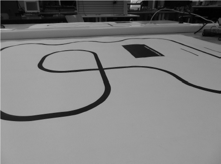

# LineFollower

lege repository die je als template kan gebruiken om een eigen repository te starten voor uw linefollower project

  
## specifications

microcontroller: ARDUINO UNO R4 Wifi board

motors: 2x DC Gearbox motor 130 RPM 

h-bridge:	Pololu DRV8833 Dual Motor Driver Carrier

sensors: Pololu QTR-8A Reflectance Sensor Array

batteries: PROCELL Intense 1,5V AA

wireless communication:

distance sensor - motors:

weight:

speed: 

